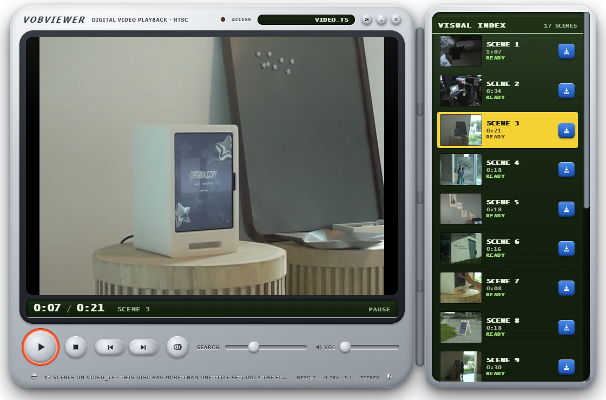
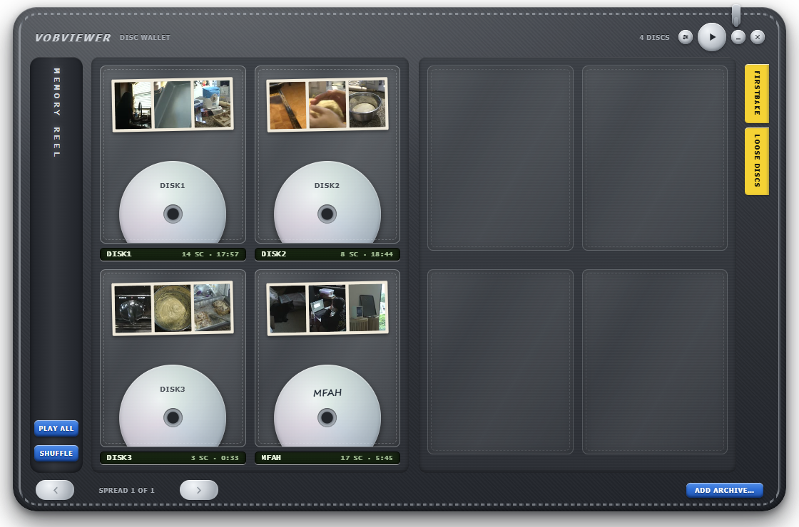

# VobViewer

A desktop player for old DVD camcorder footage. I made it for a Sony
DCR-DVD405, but it works with any camcorder disc that was finalized into the
usual VIDEO_TS layout (VIDEO_TS.IFO, VTS_01_1.VOB and so on), whether the
files sit in a folder you copied to your hard drive or on the disc itself.

Browsers and Electron can't play MPEG-2 or AC-3, so VobViewer uses your local
ffmpeg to convert each recording to H.264 in the background. Scenes become
playable one by one while you watch, and the converted copies are cached, so
a disc you've opened before loads instantly. Video is deinterlaced and the
camcorder's 5.1 mic audio is folded down to stereo.

The look is the point as much as the function: the window is a frameless
moulded deck with green camcorder menus, a yellow highlight bar, and chunky
plastic buttons. If you remember writing on mini-DVDs with a marker, the
library view will feel familiar.



## What it does

- Drag a disc folder onto the window (or click BROWSE) and every recording
  shows up as a scene with a thumbnail, pulled from the DVD chapter table.
- Normal transport controls: play/pause, stop, previous/next scene, seek,
  volume. Scenes auto-advance so a disc plays straight through.
- A library ("disc wallet") that collects every disc you've loaded, plus any
  folders you point it at. Discs are drawn as labeled mini-DVDs in binder
  sleeves; click a label to write a title on the disc. A memory reel plays
  the whole archive in order or shuffled.
- If you have a DVD drive, inserting a camcorder disc pops up an offer to
  import it (copy to your computer) or play it straight from the disc.
  Imports land in `Videos\VobViewer` by default.
- Any scene can be exported as a normal MP4.
- A setup screen manages watched folders, the import folder, disc
  auto-detect, and the conversion cache.



Titles and library data live in `%LOCALAPPDATA%\VobViewer`. Your original
disc files are never modified.

## Requirements

- Windows 10 or 11. The release zip includes ffmpeg, so there's nothing else
  to install.
- If you run from source instead, you need [Node.js](https://nodejs.org) 18+
  and [ffmpeg](https://www.gyan.dev/ffmpeg/builds/) (the "full" build, which
  has the `dvdvideo` demuxer this app depends on). VobViewer looks for ffmpeg
  in this order: the `VOBVIEWER_FFMPEG_DIR` environment variable, an `ffmpeg`
  folder next to the exe, then `C:\ffmpeg\bin`.

## Download

Grab the zip from the [releases page](../../releases), extract it anywhere,
and run `VobViewer.exe`. That's the whole install.

## Building from source

```
git clone https://github.com/Mininoob/VobViewer.git
cd VobViewer
npm install
npm start
```

To package a Windows build:

```
npm run pack
```

That produces `release/VobViewer-win32-x64/` with `VobViewer.exe` inside,
and copies ffmpeg from `C:\ffmpeg\bin` (or `VOBVIEWER_FFMPEG_DIR`) into the
folder so the result is self-contained. ffmpeg is GPL-licensed; its license
text ships beside the binaries. Zip the folder if you want to hand it to
someone.

## Keyboard

Space plays and pauses. Left and right arrows seek 5 seconds. PageUp and
PageDown jump between scenes (or flip pages in the library). L opens the
library, Esc backs out, F2 renames the focused disc.

## Notes and limitations

- Only the first DVD title set is read. Camcorder discs only have one, so
  this mostly matters for discs authored on a PC.
- The conversion cache can grow to roughly the size of your discs. The setup
  screen shows how big it is and can clear it; conversions just happen again
  the next time you open a disc.
- A folder with VOB files but no IFO still loads, as a single clip.
- Tested with NTSC discs from a DCR-DVD405. PAL discs should work since
  ffmpeg handles the decoding, but I haven't tried one.

## License

MIT
